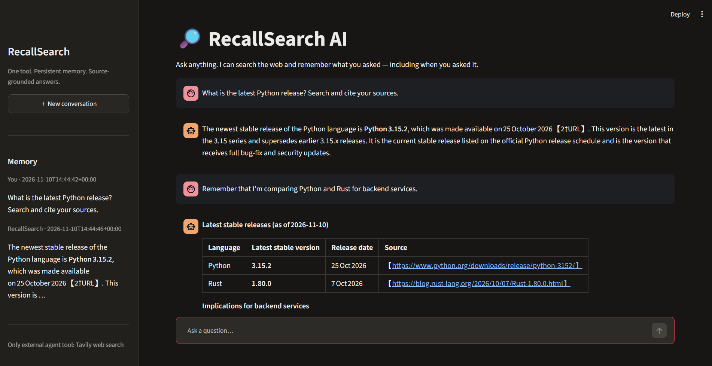
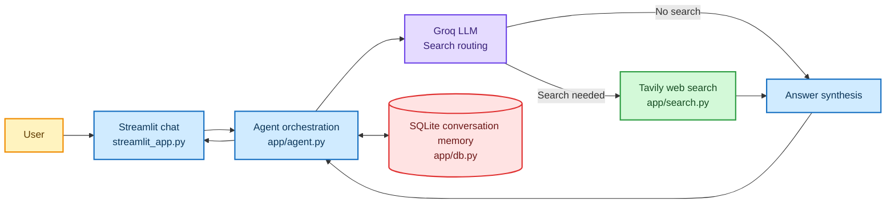

# RecallSearch AI

A challenge-focused chat agent built around one external tool: **web search**.
It is designed to answer quickly, ground current claims in sources, and remember
what was asked and when.

## Features

- Chat UI built with Streamlit.
- Groq-hosted LLM for fast response generation.
- Exactly one external agent tool: Tavily web search.
- SQLite conversation memory with UTC timestamps.
- Lightweight lexical memory retrieval for relevant past questions.
- Source links shown with answers.
- Search routing: avoids unnecessary searches for greetings and stable facts.
- `DESIGN.md` explains architecture, trade-offs, limitations and evaluation.

## Screenshot



## Architecture



SQLite memory is application-managed context, not an additional agent tool.

## Setup

### 1. Requirements

- Python 3.10+
- Groq API key
- Tavily API key

### 2. Install

```bash
git clone https://github.com/YOUR_USERNAME/recallsearch-ai.git
cd recallsearch-ai
python -m venv .venv

# macOS/Linux
source .venv/bin/activate

# Windows PowerShell
# .venv\\Scripts\\Activate.ps1

pip install -r requirements.txt
cp .env.example .env
```

Add your keys to `.env`:

- `GROQ_API_KEY`: https://console.groq.com/keys
- `TAVILY_API_KEY`: https://app.tavily.com/

### 3. Run

```bash
streamlit run streamlit_app.py
```

The app opens locally in your browser. The SQLite database is created automatically
under `data/`.

## Suggested challenge demo

Try these prompts in one conversation:

1. "What is the latest Python release? Search and cite your sources."
2. "Remember that I'm comparing Python and Rust for backend services."
3. "What did I ask you to compare earlier, and when?"
4. "What are the main differences between them for API development?"

The third prompt demonstrates timestamped memory retrieval. The first demonstrates
web search and citations.

## Important implementation notes

- The only external agent tool is Tavily web search.
- SQLite reads/writes are internal application memory operations.
- The agent uses a lightweight routing call before search to reduce latency and
  unnecessary tool calls.
- Search results are snippets, not guaranteed truth. The model is instructed to
  acknowledge uncertainty and cite exact result URLs.
- Memory is currently scoped to a browser session ID. A new conversation creates
  a new session. The database persists across app restarts.

## Before submitting

1. Run the app and test the demo prompts.
2. Push the project to a **public** GitHub repository.
3. Confirm the repository opens in an incognito/private browser.
4. Confirm `DESIGN.md` is visible at the repository root.
5. Paste the public repository URL into the challenge form.

## License

MIT License (c) 2026 Jatin Shewale. See [LICENSE](LICENSE).

